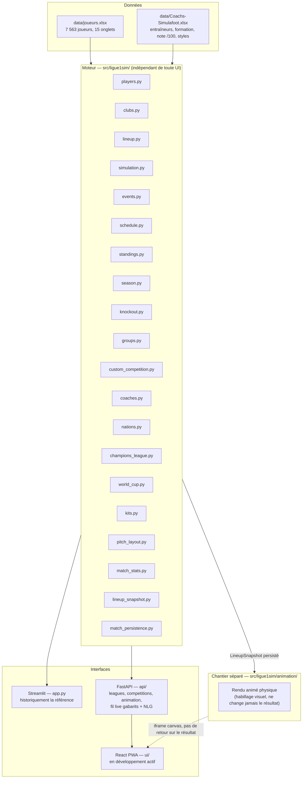

# PROJET SIMULAFOOT

**Version du document :** 1.1
**Dernière mise à jour :** 07/10/2026
**Statut :** Vivant — à tenir à jour à chaque décision, script, changement de données ou évolution
**Auteur :** Olivier Mariani (porteur du projet), document rédigé et maintenu par l'assistant IA en session Claude Code
**Méthode de rédaction :** lecture directe du code, des données et des documents internes existants (état initial du 28/09/2026, puis réalignement du 07/10/2026 sur le dépôt après la phase de résorption) — pas de mémoire de conversation ni d'invention — voir [§0 Méthode](#0-méthode-et-fiabilité-des-informations)

## Résumé exécutif

Simulafoot est un simulateur de football au niveau **joueur** (pas juste un score de club) : calendrier généré automatiquement, dispositif tactique adapté à l'effectif du jour, buteurs/passeurs, notes, cartons, blessures, suspensions, classements et classements buteurs/passeurs. Le moteur (`src/ligue1sim/`, indépendant de toute interface) simule les 8 grands championnats européens + Championship anglaise, la Ligue des Champions, la Coupe du Monde, les sélections nationales, et une **Compétition Perso** entièrement personnalisable.

La base de données compte **7 563 joueurs** (`data/joueurs.xlsx`, mesuré le 07/10/2026), enrichie progressivement avec **47 attributs FM26** scrapés sur fminside.net (**6 193 joueurs enrichis, 81,9 %**) via un algorithme de matching anti-homonymes. Les entraîneurs et sélectionneurs (nom, dispositif préférentiel, note /100, styles de jeu) viennent de `data/Coachs-Simulafoot.xlsx` et modulent légèrement le résultat (±3 % coach, ±15 % styles, voir [§14.2 bis](#142-bis-modulateurs-coach-et-styles-3c-décision-d5-du-07102026)). Deux interfaces coexistent : une app **Streamlit** (`app.py`, historiquement la référence) et une **PWA React + API FastAPI** (`ui/`, `api/`), qui est l'interface lancée par `simulafoot.bat` et la seule où sont branchés le rendu animé des matchs, le fil de commentaire « live » et les statistiques de match (voir [§6](#6-architecture-générale)). Le rendu animé physique (`src/ligue1sim/animation/`, `render/canvas.html`) est un chantier séparé du moteur de résultat : il rejoue une compo réellement jouée (`LineupSnapshot`) sans jamais changer le score.

---

## Table des matières

0. [Méthode et fiabilité des informations](#0-méthode-et-fiabilité-des-informations)
1. [Changelog](#1-changelog)
2. [Vision et objectifs](#2-vision-et-objectifs)
3. [Périmètre](#3-périmètre)
4. [Utilisateurs cibles et cas d'usage](#4-utilisateurs-cibles-et-cas-dusage)
5. [Concepts métier](#5-concepts-métier)
6. [Architecture générale](#6-architecture-générale)
7. [Modèle de données](#7-modèle-de-données)
8. [Pipeline de collecte (scraping fminside)](#8-pipeline-de-collecte-scraping-fminside)
9. [Algorithme de matching anti-homonymes](#9-algorithme-de-matching-anti-homonymes)
10. [Attributs FM26](#10-attributs-fm26)
11. [Note de référence du joueur](#11-note-de-référence-du-joueur)
12. [Scripts](#12-scripts)
13. [UI/UX](#13-uiux)
14. [Moteur de simulation](#14-moteur-de-simulation)
15. [Chantier simulation physique (rendu animé)](#15-chantier-simulation-physique-rendu-animé)
16. [Roadmap](#16-roadmap)
17. [Décisions structurantes (ADR)](#17-décisions-structurantes-adr)
18. [Risques et limites](#18-risques-et-limites)
19. [Tests et qualité](#19-tests-et-qualité)
20. [Déploiement et exploitation](#20-déploiement-et-exploitation)
21. [Glossaire](#21-glossaire)
22. [Annexes](#22-annexes)

---

## 0. Méthode et fiabilité des informations

Ce document est écrit à partir d'une **lecture directe** du code source, des fichiers de données (`data/*.xlsx`), des tests, et des documents internes existants (`README.md`, `docs/*.md`) au 28/09/2026 — jamais de la mémoire de conversation, jamais d'invention. Chaque affirmation factuelle (nombre de joueurs, formules, colonnes, etc.) est vérifiable dans le fichier cité en regard.

**Limite connue de cette version** : `data/joueurs.xlsx` était **ouvert (verrouillé) au moment de la rédaction**, ce qui a bloqué deux vérifications :
- l'application d'une mise en forme visuelle sur la colonne « Moyenne joueur » (alors colonne P, désormais Q), demandée en séance (voir [§11](#11-note-de-référence-du-joueur)) ;
- une relecture complète de l'onglet "Description des rôles FM" (glossaire des 73 rôles FM26, [§21](#21-glossaire)).

**Action à faire par Olivier** : fermer `data/joueurs.xlsx` dans Excel, puis redemander ces deux points.

**Mise à jour du 07/10/2026** : cette version est réalignée sur l'état réel du dépôt après la phase de résorption (commits 3a, Lot 1, Lot 2, 3b, 3c, docstrings des coachs, Lot 4, Lot 5). Les faits ont été revérifiés dans le code, dans le classeur (lecture seule : `data/joueurs.xlsx` n'était pas verrouillé) et dans les tests. Le point de [§11.3](#113-mise-en-forme-visuelle-de-la-colonne-moyenne-joueur-demandée-en-séance) (mise en forme de la colonne « Moyenne joueur ») n'a **pas** été revérifié. Les tickets de dette ne sont pas dupliqués ici : voir `docs/known_issues.md`. Ce qui n'est pas implémenté est marqué « prévu, non implémenté ».

---

## 1. Changelog

| Version | Date | Auteur | Description |
|---|---|---|---|
| 1.0 | 28/09/2026 | Assistant IA (session Claude Code) | Création initiale du document, à partir d'une lecture complète du code/données existants. Périmètre couvert : moteur, données, scraping, matching, attributs FM26, note de référence, scripts, UI (Streamlit + React), architecture, roadmap, ADR, risques, tests, déploiement, glossaire. |
| 1.1 | 07/10/2026 | Assistant IA (session Claude Code) | Réalignement sur l'état réel du dépôt après la phase de résorption : effectif et colonnes de `joueurs.xlsx` (7 563 joueurs, « Moyenne joueur » en colonne Q), coachs (`Coachs-Simulafoot.xlsx`), formule de résultat et modulateurs coach/styles (3c), API (animation, fil live, NLG), écrans React, rendu animé en iframe, tests, renvoi des tickets à `docs/known_issues.md`, roadmap. |

**Règle de tenue à jour** (rappel) : toute nouvelle information, décision, script, changement de données, correction ou évolution donne lieu à une entrée changelog + mise à jour des sections concernées. Rien n'est supprimé de l'historique ; une section obsolète est marquée comme telle, pas effacée.

---

## 2. Vision et objectifs

**But du projet.** Offrir une simulation de football crédible et rejouable, au niveau joueur (pas au niveau "score de club" comme la plupart des simulateurs simplistes), sur une base de données réelle (effectifs, notes, attributs FM26) et sur un vivier de compétitions large (8 championnats + Championship, Ligue des Champions, Coupe du Monde, sélections, et des compétitions entièrement personnalisées).

**Problème résolu.** Les simulateurs de résultats classiques (Poisson pur sur une force de club statique) ignorent la composition réelle d'une équipe un jour donné (blessures, suspensions, dispositif tactique) et ne produisent aucun récit de match (buteurs, passeurs, cartons, notes individuelles). Simulafoot calcule une compo réaliste **à la volée** à partir de l'effectif disponible, puis distribue les événements du match sur cette compo — voir [§14](#14-moteur-de-simulation).

**Valeur ajoutée.**
- Compo tactique adaptée à l'effectif du jour (pas de force de club figée — voir [§17, ADR-002](#17-décisions-structurantes-adr)).
- Récit de match complet et cohérent statistiquement (buteurs/passeurs pondérés par poste, cartons, blessures, notes bornées).
- Calibrage mesuré sur des dizaines de milliers de matchs simulés (voir [§14.2](#142-formule-de-résultat-poisson-façon-dixon-coles)), pas des réglages empiriques non vérifiés.
- Base de données enrichie avec de vrais attributs FM26 pour décrire finement le profil de chaque joueur dans l'UI (radar, barres par catégorie).
- Compétition Perso : aucune limite au choix des clubs (y compris hors des 8 championnats officiels), trois formats de compétition.

---

## 3. Périmètre

### 3.1 Inclus (fonctionnel)

- Simulation de saison complète pour 8 championnats européens + Championship anglaise (via "Angleterre" → 2 championnats).
- Ligue des Champions (36 clubs, format "Swiss" approximé), Coupe du Monde (32 sélections), sélections nationales hors CDM.
- Compétition Perso : championnat libre, élimination directe, ou hybride poules + élimination, clubs et sélections mélangeables, 3 formats de confrontation (simple/aller-retour/double aller-retour).
- Simulation au niveau joueur : compo tactique adaptative, buteurs/passeurs, cartons, blessures, suspensions, notes /10, classements, classements buteurs/passeurs.
- Deux interfaces utilisables : Streamlit (`app.py`) et PWA React (`ui/`).
- Statistiques de match (possession, tirs, tirs cadrés, xG) fabriquées après coup à partir du score et du lambda (`match_stats.py`), et fil de commentaire « live » d'un match joué (gabarits `api/live_commentary.py`, ou NLG `simulafoot_nlg/` via `api/nlg_live.py` avec repli sur les gabarits) — exposés par l'API et affichés dans la PWA.
- Rendu animé des temps forts d'un match joué dans la PWA (bouton « Voir l'animation », iframe `render/canvas.html`), à partir de la compo persistée (`LineupSnapshot`).
- Pipeline d'enrichissement des joueurs avec 47 attributs FM26 (scraping fminside.net + matching anti-homonymes).

### 3.2 Exclus (révisé le 07/10/2026)

- Pas de note FM globale concurrente de "Moyenne joueur" (décision actée, voir [§11](#11-note-de-référence-du-joueur)).
- Pas de persistance disque de l'état d'une saison/compétition (mémoire process uniquement, voir [§18](#18-risques-et-limites)).
- Rendu animé : intégré à la **PWA React** uniquement (voir [§15](#15-chantier-simulation-physique-rendu-animé)) ; **non** branché dans `app.py` (Streamlit). Pas de simulation physique « en direct » du match : l'animation rejoue après coup un résultat déjà décidé.
- Pas de règle de confrontations directes en cas d'égalité stricte au classement.
- Pas de compte utilisateur, pas de multijoueur, pas de sauvegarde de partie nommée.

### 3.3 Non fonctionnel

- Déterminisme : non recherché à l'échelle du résultat sportif (tirages aléatoires assumés — Poisson, buteurs, cartons) ; recherché en revanche dans le chantier de rendu animé (amplitudes dérivées d'un hash déterministe, pas de `random`, voir [§15](#15-chantier-simulation-physique-rendu-animé)).
- Performance : lecture de `data/joueurs.xlsx` mise en cache (`@lru_cache`) côté moteur.
- Portabilité : projet stocké sur OneDrive, `link-mode = "copy"` forcé dans `pyproject.toml` car OneDrive bloque le hardlinking `uv` sur fichiers synchronisés cloud.

---

## 4. Utilisateurs cibles et cas d'usage

**Persona unique aujourd'hui : Olivier**, porteur du projet, utilisateur principal et testeur. Le projet n'a pas d'autre utilisateur identifié à ce stade (pas de déploiement public, pas de compte).

**Cas d'usage principaux (observés dans le code/UI, pas déclarés séparément) :**

| Cas d'usage | Écran(s) concerné(s) | Interface |
|---|---|---|
| Lancer la saison d'un championnat officiel et la simuler journée par journée | Accueil → Championnats → écran de saison | Streamlit + React |
| Construire une Compétition Perso (clubs/sélections libres) | Assistant 4 étapes | Streamlit + React |
| Consulter le détail d'un match joué (compo, buteurs, notes) | Écran match / vue terrain | Streamlit + React |
| Consulter la fiche d'un club (effectif, forces) | Fiche club | Streamlit + React |
| Consulter la fiche d'un joueur (profil, attributs FM26, radar) | Fiche joueur | Streamlit + React |
| Suivre un classement (points, buteurs, passeurs) | Écran classement | Streamlit + React |
| Enrichir la base de joueurs avec des attributs FM26 | — (hors UI) | `scripts/scrape_fminside_attributes.py` |
| Calibrer le moteur après un changement de formule | — (hors UI) | `scripts/calibrate_engine.py` |

---

## 5. Concepts métier

### 5.1 Postes

12 postes (diminutifs définis dans l'onglet "Postes" de `data/joueurs.xlsx`, voir `players.py`) :

| Poste | Libellé | Groupe |
|---|---|---|
| GK | Gardien | GK |
| DC | Défenseur central | DEF |
| LB | Latéral gauche | DEF |
| RB | Latéral droit | DEF |
| MDC | Milieu défensif | MID |
| MC | Milieu central | MID |
| MOC | Milieu offensif | MID |
| AG | Ailier gauche | ATT |
| AD | Ailier droit | ATT |
| SA | Second attaquant | ATT |
| BU | Buteur | ATT |
| ATT | Attaquant polyvalent (sans équivalent Transfermarkt direct) | ATT |

Nomenclature volontairement plus large que Transfermarkt d'origine (AD/AG fusionnent milieu latéral et ailier pur).

### 5.2 Rôles FM26 (glossaire, pas une note)

L'onglet **"Description des rôles FM"** de `data/joueurs.xlsx` liste **73 rôles officiels Football Manager 26** (colonnes : Rôle, Catégorie [`In-Possession` / `Out-of-Possession` / `Les deux`], Famille de poste, Description) — un **glossaire de référence**, pas une note ou une matrice de pondération par joueur. L'ancien onglet "Roles" (notes de rôle par joueur) est marqué **obsolète** dans le classeur lui-même, remplacé par ce glossaire. Aucun code (`lineup.py`/`simulation.py`/`events.py`) ne lit de rôle par joueur — voir [§11](#11-note-de-référence-du-joueur) et [§17, ADR-001](#17-décisions-structurantes-adr).

### 5.3 Notes et échelles

| Notion | Échelle | Colonne / source |
|---|---|---|
| Note de référence du joueur ("Moyenne joueur") | 0–100 | `data/joueurs.xlsx`, colonne **Q** (P avant l'insertion de « Preferred moves » en O) |
| Note Transfermarkt d'origine | — | colonne K, **non lue par le code** |
| Attributs FM26 (47) | 0–99 (échelle FM native) | colonnes fminside, recentrées voir [§11](#11-note-de-référence-du-joueur) |
| Note de match individuelle | 3–10 | calculée par `events.py` (base + résultat + événements + bruit, bornée) |
| Weak foot | /5 | colonne "Weak foot (/5)" |

### 5.4 Style de jeu ("Catégorie")

Colonne "Catégorie" de `Player` (ex. `buteur_axial`) : un tag de style de jeu, distinct des attributs FM26 et des rôles — absent pour la plupart des joueurs (voir `docs/Description catégories joueurs` dans le classeur).

---

## 6. Architecture générale

### 6.1 Vue d'ensemble



### 6.2 Statut des deux interfaces (décision de la session du 28/09/2026)

Les deux interfaces **coexistent activement** :

- **Streamlit (`app.py`, 2298+ lignes)** : historiquement l'interface de référence (confirmé le 22/09/2026), continue de recevoir des commits actifs (fiche joueur, écran équipe).
- **React/FastAPI (`ui/` + `api/`)** : introduite début septembre 2026 (commit `9d43df1`), a fait l'objet d'un développement soutenu lors de la session du 28/09/2026 (logos de club, fiche joueur, radar interactif, écran match repensé avec pelouse réaliste et bancs de touche). Statut retenu : **chantier parallèle activement développé, pas (encore) promu comme unique référence** — à réévaluer.

> ❓ **Point à trancher plus tard** : à mesure que React se développe, faudra-t-il officiellement basculer la référence, ou les deux interfaces resteront-elles maintenues en parallèle durablement ? Pas de décision figée à ce jour.

**Constat au 07/10/2026** : `simulafoot.bat` ne lance plus que l'API FastAPI (port 8000) et la PWA (port 5173) — son commentaire indique que « l'appli est passée de Streamlit à une PWA React + API FastAPI ». Le rendu animé, le fil de commentaire live et les statistiques de match ne sont branchés que dans la PWA. `app.py` et `apps/streamlit_preview.py` existent toujours. La décision formelle de référence reste à trancher par le propriétaire (voir ADR-006).

### 6.3 Stack technique

| Couche | Techno |
|---|---|
| Langage moteur | Python 3.12 |
| Gestion d'environnement | `uv` (`pyproject.toml` + `uv.lock`) |
| Données | pandas + openpyxl (lecture `.xlsx`) |
| Simulation | numpy (Poisson, tirages pondérés) |
| Tests | pytest |
| UI historique | Streamlit |
| API | FastAPI, Pydantic (`api/schemas.py`), uvicorn |
| UI React | React 19, Vite, Tailwind 4, `react-router-dom` 7, Zustand, `framer-motion`, `lucide-react`, `vite-plugin-pwa` |
| État des compétitions (API) | dict en mémoire process-local (`api/store.py`), aucune persistance |
| Scraping | `curl_cffi` (impersonation Chrome, contourne Cloudflare) ou `requests` en repli, BeautifulSoup |
| Commentaire live | Gabarits (`api/live_commentary.py`) ou NLG (`simulafoot_nlg/`, processus et venv séparés, `duckdb`), appelé par `api/nlg_live.py` |
| Rendu animé | `render/canvas.html` (canvas 2D autonome, sans dépendance externe), monté dans une iframe par la PWA |

### 6.4 API FastAPI — surface actuelle

| Route | Méthode | Rôle |
|---|---|---|
| `/api/leagues` | GET | Liste des championnats |
| `/api/clubs` | GET | Liste des clubs |
| `/api/nations` | GET | Liste des sélections |
| `/api/competitions` | POST | Créer une compétition |
| `/api/competitions/champions-league` | POST | Créer la Ligue des Champions |
| `/api/competitions/world-cup` | POST | Créer la Coupe du Monde |
| `/api/competitions/{id}` | GET | Statut d'une compétition |
| `/api/competitions/{id}/simulate-current` | POST | Simuler la journée courante |
| `/api/competitions/{id}/advance` | POST | Avancer d'une journée |
| `/api/competitions/{id}/simulate-all` | POST | Simuler jusqu'au bout |
| `/api/competitions/{id}/standings` | GET | Classement |
| `/api/competitions/{id}/clubs/{club}/roster` | GET | Effectif d'un club |
| `/api/competitions/{id}/leaderboards` | GET | Classements buteurs/passeurs |
| `/api/competitions/{id}/matches` | GET | Calendrier d'une journée |
| `/api/competitions/{id}/pitch` | GET | Vue terrain d'un match : compo, bancs, indisponibles, entraîneurs, statistiques de match (`home_stats`/`away_stats`) et fil live (`live`) |
| `/api/competitions/{id}/animation` | GET | Clips d'animation d'un match joué (`api/animation.py`) ; répond `{"available": false, "reason": …}` si le match n'est pas animable (non joué, compo non persistée) |
| `/api/competitions/{id}/groups` | GET | Poules |
| `/api/competitions/{id}/groups/simulate-matchday` | POST | Simuler une journée de poules |
| `/api/competitions/{id}/knockout/start` | POST | Démarrer la phase à élimination |
| `/api/competitions/{id}/bracket` | GET | Tableau à élimination |
| `/api/competitions/{id}/bracket/simulate-round` | POST | Simuler un tour du tableau |
| `/api/competitions/{id}/bracket/advance` | POST | Avancer le tableau |

**Modules `api/`** (07/10/2026) : `main.py` (montage, fichiers statiques, `ui/dist`), `routers/` (`leagues`, `competitions`), `schemas.py` (Pydantic), `serializers.py`, `store.py` (état en mémoire), `animation.py` (clips), `live_commentary.py` (fil live à gabarits), `nlg_live.py` (fil live NLG, repli sur les gabarits si le NLG est indisponible).

### 6.5 Écrans React (`ui/src/routes/`)

`Home`, `Leagues`, `Nations`, `CustomCompetition`, `Simulation`, `Standings`, `TeamRoster`, `PlayerPage` (fiche joueur, écran indépendant), `PitchView`, `Groups`, `Bracket`, `Leaderboards` (12 routes sous `ui/src/routes/`).

`PitchView` assemble `PitchField` (pelouse), `LivePanel` (fil de commentaire live) et `GoalAlerts`/`MultiplexTicker` (buts des autres matchs de la journée). L'en-tête de match (`MatchHeader`) est un composant interne de `PitchView.jsx`, pas un fichier séparé. Le bouton « Voir l'animation » ouvre une fenêtre (`AnimationDialog`) qui monte `MatchAnimation` (iframe `render/canvas.html`, `ui/src/utils/matchAnimation.js`). `LiveButton` (`components/common/`) ouvre le live d'un match depuis les listes. Voir [§13.2](#132-react-pwa-ui).

---

## 7. Modèle de données

### 7.1 `data/joueurs.xlsx` — onglets

| Onglet | Contenu |
|---|---|
| **Infos principales** | Une ligne par joueur — voir [§7.2](#72-onglet-infos-principales--colonnes) |
| notice | Conventions de saisie |
| Dispositifs tactiques | Poste attendu à chaque place, par dispositif jouable (4-2-3-1, 4-4-2, 4-3-3, 3-4-2-1, 3-5-2, 3-4-3) |
| Preferred moves | Les 55 « preferred moves » présents dans la base, avec leur traduction française (ajouté depuis le 28/09/2026, décision D1). L'ancien onglet « Statuts » n'existe plus au 07/10/2026 |
| Postes | Référentiel des postes |
| Roles | **Obsolète**, remplacé par "Description des rôles FM" |
| Caractéristiques | **Obsolète** — remplacée par les 47 colonnes d'attributs FM26 de « Infos principales » |
| Description des rôles FM | Glossaire des 73 rôles FM26 (voir [§5.2](#52-rôles-fm26-glossaire-pas-une-note)) |
| Description catégories joueurs | Référentiel des styles de jeu ("Catégorie") |
| Ligue des Champions | 36 clubs qualifiés, chapeaux |
| Europe / Afrique / Amérique / Asie / Océanie | Sélections nationales par confédération |

### 7.2 Onglet "Infos principales" — colonnes

**7 563 joueurs** (vérifié le 07/10/2026 : 7 563 lignes renseignées sous l'en-tête ; décision D1 : doublon « Lucas Paquetá » (CR Flamengo) supprimé, 82 notes « Moyenne joueur » modifiées, colonnes Ability/Note FM retirées).

| Colonne (lettre) | Nom | Type / valeurs | Utilisée par le moteur ? |
|---|---|---|---|
| A | ID | entier | Oui — recroisement avec les autres onglets |
| B | Colonne1 | — | ❓ non identifiée dans le code lu |
| C | Prénom | texte | Oui |
| D | Nom | texte | Oui |
| E | Nationalité | texte | Oui |
| F | Âge | entier | Oui |
| G | Poste | code poste (voir [§5.1](#51-postes)) | Oui |
| H | Club | texte | Oui |
| I | Championnat | texte | Oui |
| J | Valeur marchande | € (millions) | Affichage uniquement |
| K | Note transfermrkt | — | **Non lue par le code** (voir [§11](#11-note-de-référence-du-joueur)) |
| L | Taille (cm) | entier | ❓ usage non confirmé dans le code lu |
| M | Statut | tag (voir onglet Statuts) | ❓ usage non confirmé |
| N | Catégorie | style de jeu | Affichage (radar/UI) |
| O | Preferred moves | texte (mouvements préférés FM) | Affichage ; renseigné pour 796 joueurs sur 7 563 (scraping connecté, voir [§8](#8-pipeline-de-collecte-scraping-fminside)) |
| P | Pieds | "D" / "G" | Affichage |
| **Q** | **Moyenne joueur** | **0–100** | **Oui — SEULE note utilisée par le moteur** (`clubs.NOTE_COLUMN`, lue par nom d'en-tête ; colonne P le 28/09/2026) |
| R–BL (47 colonnes) | Attributs FM26 (Crossing → Penalty Taking) | 0–99 | Affichage uniquement (voir [§10](#10-attributs-fm26)) |
| BM | FMInside URL | URL | Pipeline de scraping (clé de reprise) ; renseignée pour 7 037 joueurs |
| BN | Postes FM naturels | texte (ex. "DR, WBR") | Affichage |
| BO | Taille FM (cm) | entier | Affichage |
| BP | Weak foot (/5) | 1–5 | Affichage |

**Contraintes/règles de gestion connues :**
- `clubs.py` valide que `NOTE_COLUMN` (Moyenne joueur) est dans `[0, 100]` (`out_of_range` check).
- Les 47 colonnes d'attributs sont **ajoutées uniquement**, jamais retouchées manuellement (convention du script de scraping).
- Séparation prénom/nom par simple découpage du premier mot — imparfait pour noms composés/ordres non occidentaux (limite connue, voir [§18](#18-risques-et-limites)).

### 7.3 `data/Coachs-Simulafoot.xlsx`

Une ligne par club ou sélection (268 lignes de données, un seul onglet `Sheet1`) : `Club`, `Entraineur`, `Formation` (dispositif préférentiel), `Note /100`, puis cinq colonnes de styles marquées d'un « X » (`Contre attaque`, `Pressing`, `Défensif`, `Offensif`, `Possession`). Lu par `coaches.py` (`coach_name`, `preferred_formations`, `coach_note`, `coach_styles`, `average_note`), avec repli silencieux si le fichier ou le club est absent. Remplace `data/entraineurs.xlsx` (commit 3b `3070543`), qui n'est plus lu par le code. La note et les styles modulent le résultat (voir [§14.2 bis](#142-bis-modulateurs-coach-et-styles-3c-décision-d5-du-07102026)).

### 7.4 Classe `Player` (`players.py`)

```python
@dataclass(frozen=True)
class Player:
    prenom: str
    nom: str
    nationalite: str
    age: int
    poste: str
    note: float                          # colonne Q, Moyenne joueur
    club: str
    championnat: str
    poste_secondaire: tuple[str, ...] = ()
    categorie: str | None = None
    id: int | None = None
    attributes: dict[str, int] | None = None   # 47 attributs FM26, None si non enrichi
    postes_fm: str | None = None
    taille_fm: int | None = None
    weak_foot: float | None = None
    preferred_moves: str | None = None
    valeur_marchande: float | None = None
    pied: str | None = None
```

### 7.5 Classe `Club` (`clubs.py`)

Pas de note de club stockée — `Club(name, players)` ne stocke qu'un nom et un effectif. Toute force de club (calibrage Poisson, têtes de série) est **calculée à la volée** depuis l'effectif disponible *au moment du calcul* (`lineup.club_strength`) — un club affaibli par des blessures/suspensions est réellement plus faible ce jour-là.

---

## 8. Pipeline de collecte (scraping fminside)

**Script :** `scripts/scrape_fminside_attributes.py` (900 lignes).

### 8.1 Principe (5 étapes)

1. Lit l'onglet "Infos principales" (ID, Prénom, Nom, Nationalité, Âge, Poste, Club, Moyenne joueur).
2. Pour chaque joueur, interroge le filtre de la base joueurs fminside (joueurs **hommes** uniquement, DB version "7" = FM26), par nom + nationalité + tranche d'âge, avec requêtes de repli.
3. Note chaque candidat et n'accepte un match que si le score dépasse un seuil **et** l'écart avec le 2ᵉ candidat est net — voir [§9](#9-algorithme-de-matching-anti-homonymes).
4. Récupère les attributs sur la fiche du joueur retenu, écrit dans de **nouvelles colonnes uniquement** (jamais de colonne existante modifiée) + infos complémentaires (postes naturels, taille, weak foot, preferred moves si `--cookie`).
5. Produit un rapport CSV de matching + accepte un fichier de corrections manuelles.

### 8.2 Fichiers produits (même dossier que `joueurs.xlsx`)

| Fichier | Rôle |
|---|---|
| `fminside_matching_report.csv` | Décision pour chaque joueur traité + meilleur/2ᵉ candidat |
| `fminside_overrides.csv` | Corrections manuelles (`ID;url`, `url=SKIP` pour ignorer) |
| `.fminside_cache.json` | Cache des recherches et fiches (relances rapides, reprise après arrêt) |
| `joueurs_backup_YYYYMMDD_HHMMSS.xlsx` | Sauvegarde automatique avant chaque écriture |

### 8.3 Robustesse

- Cache JSON permettant une **reprise** après interruption, sans re-scraper ce qui est déjà connu.
- Sauvegarde automatique avant toute écriture (convention reprise pour la mise en forme de la colonne « Moyenne joueur », voir [§11](#11-note-de-référence-du-joueur)).
- `curl_cffi` (impersonation navigateur) pour contourner Cloudflare ; repli sur `requests`.
- **Contrainte opérationnelle** : `joueurs.xlsx` doit être **fermé dans Excel** avant de lancer le script (l'écriture échoue sinon — vérifié en séance le 28/09/2026, voir [§0](#0-méthode-et-fiabilité-des-informations)).

### 8.4 État d'avancement (vérifié le 07/10/2026)

| Indicateur | Valeur |
|---|---|
| Joueurs au total | 7 563 |
| Reliés à une fiche fminside (`FMInside URL` renseignée) | 7 037 (93,0 %) |
| Attributs FM26 effectivement récupérés | 6 193 (81,9 %) |

> Mesuré le 07/10/2026 (lecture seule du classeur) ; mêmes chiffres qu'au 28/09/2026 pour les URL et les attributs. Ils progressent au fil des lancements du script — à revérifier avant toute décision qui en dépend. `Preferred moves` : 796 joueurs renseignés.

### 8.5 Commandes usuelles

```bash
# test sur 30 joueurs, sans écrire dans l'Excel (rapport seulement)
python scripts/scrape_fminside_attributes.py --limit 30 --dry-run

# joueurs précis
python scripts/scrape_fminside_attributes.py --ids 3,4,1471,3851

# tout le fichier, par lots de 500 (reprend où il s'est arrêté)
python scripts/scrape_fminside_attributes.py --limit 500

# compléter postes/taille/weak foot (et moves si --cookie) des joueurs déjà reliés
python scripts/scrape_fminside_attributes.py --extras-only --cookie "COPIE_DU_COOKIE"
```

Cookie fminside (pour les preferred moves) : Chrome connecté à fminside → F12 → Réseau → recharger une fiche joueur → 1ʳᵉ requête → En-têtes → copier `cookie` (ou variable d'environnement `FMINSIDE_COOKIE`).

---

## 9. Algorithme de matching anti-homonymes

**Objectif :** relier chaque joueur de `joueurs.xlsx` à sa bonne fiche fminside, sans jamais assigner une fiche à la mauvaise personne (deux joueurs homonymes, par exemple).

### 9.1 Paramètres de seuillage (`scrape_fminside_attributes.py`)

| Constante | Valeur | Rôle |
|---|---|---|
| `MIN_SCORE` | 16.0 | Score minimum pour qu'un candidat soit accepté |
| `MIN_MARGIN` | 4.0 | Écart minimum avec le 2ᵉ candidat pour lever l'ambiguïté |
| `MIN_NAME` | 0.70 | Similarité de nom minimum pour qu'un candidat soit seulement envisagé |
| `MAX_PAGES` | 10 | Pages de 50 lignes max par requête de recherche |

### 9.2 Règles de décision

- Chaque candidat est noté (`score_candidate`, nom + nationalité + âge + club + poste + niveau).
- Un candidat n'est accepté que si **score > MIN_SCORE ET (score − score du 2ᵉ) > MIN_MARGIN**.
- Si l'écart est insuffisant → **AMBIGU**, rien n'est écrit.
- Si une même fiche fminside est attribuée à 2 lignes Excel différentes → **CONFLIT**, rien n'est écrit.
- La similarité de nom utilise `difflib.SequenceMatcher` (`MIN_NAME` comme filtre d'entrée dans la liste de candidats envisagés).
- Table de correspondance nationalités Excel (FR) → libellés fminside (EN) pour le filtre serveur et la comparaison ; pays absent de la table comparé tel quel.

### 9.3 Cas limites et rapport

Toute décision **AMBIGU**, **INTROUVABLE** ou **CONFLIT** est journalisée dans `fminside_matching_report.csv`, avec le meilleur et le 2ᵉ candidat, pour relecture manuelle. Le fichier `fminside_overrides.csv` permet de forcer une correspondance (ou un `SKIP`) sans modifier le code.

> ❓ **Non vérifié dans cette session** : le détail exact de la fonction `score_candidate` (pondération de chaque critère : nom/nationalité/âge/club/poste/niveau) n'a pas été lu ligne à ligne — à documenter si une revue fine de l'algorithme est nécessaire (voir `scripts/scrape_fminside_attributes.py`).

---

## 10. Attributs FM26

**47 attributs**, mêmes noms que fminside.net, organisés en 5 catégories (source de vérité partagée entre `scripts/scrape_fminside_attributes.py` et `players.FM_ATTRIBUTE_CATEGORIES` — ne jamais les laisser diverger) :

| Catégorie | Nombre | Attributs |
|---|---|---|
| Technique | 10 | Crossing, Dribbling, Finishing, First Touch, Heading, Long Shots, Marking, Passing, Tackling, Technique |
| Gardien | 11 | Aerial Reach, Command of Area, Communication, Eccentricity, Handling, Kicking, One on Ones, Punching (Tendency), Reflexes, Rushing Out (Tendency), Throwing |
| Mental | 14 | Aggression, Anticipation, Bravery, Composure, Concentration, Decisions, Determination, Flair, Leadership, Off the Ball, Positioning, Teamwork, Vision, Work Rate |
| Physique | 8 | Acceleration, Agility, Balance, Jumping Reach, Natural Fitness, Pace, Stamina, Strength |
| Coups de pied arrêtés | 4 | Corners, Free Kick Taking, Long Throws, Penalty Taking |

**Échelle :** 0–99 (échelle FM native), tirée telle quelle de la fiche fminside puis **recentrée** sur la note de référence du joueur — voir [§11](#11-note-de-référence-du-joueur).

**Particularités :**
- "Punching (Tendency)" et "Rushing Out (Tendency)" sont des **tendances comportementales**, pas des notes de niveau (une valeur haute ne veut pas dire "bon à ça", juste "enclin à le faire").
- Disponibles pour **6 193 joueurs / 7 563** (81,9 %) au 07/10/2026 — toujours vérifier `player.attributes is not None` avant utilisation (peut être `None`).
- Les "Rôles" FM26 (voir [§5.2](#52-rôles-fm26-glossaire-pas-une-note)) et une éventuelle note "Ability" globale ont été **retirés du scraping le 25–26/09/2026** — voir [§17, ADR-001](#17-décisions-structurantes-adr).

---

## 11. Note de référence du joueur

> **Décision confirmée en séance le 28/09/2026 (question posée à Olivier, réponse reçue) :** la colonne **Q (« Moyenne joueur »)** (colonne P avant le 07/10/2026) est bien LA note à utiliser pour la valeur d'un joueur et donc d'un club — **jamais** "Note transfermrkt" (colonne K).

### 11.1 Vérification faite

- `clubs.py` : `NOTE_COLUMN = "Moyenne joueur"` — confirmé, c'est déjà la colonne utilisée par tout le moteur (force de club, calibrage Poisson, têtes de série).
- Recherche exhaustive de `"transfermrkt"` dans tout le code (`.py`/`.js`/`.jsx`) : **aucune occurrence** — la colonne K n'est lue nulle part. **Aucune correction de code n'était nécessaire.**

### 11.2 Pourquoi une note FM séparée a été abandonnée

Décision actée le 26/09/2026 (commentaire `scripts/scrape_fminside_attributes.py` + `players.weighted_attributes`) : pas de note globale FM ("Ability") concurrente de "Moyenne joueur". Les 47 attributs FM26 servent **uniquement** à décrire le profil du joueur (radar, barres par catégorie dans l'UI) — ils **n'entrent dans aucune note**.

Pour que ce profil reste cohérent avec "Moyenne joueur" (éviter qu'un joueur affiché à 74 de moyenne ait des attributs qui, moyennés, donneraient 60 ou 90), `players.weighted_attributes(attributes, note, poste)` **recentre** les attributs bruts scrapés (appelée au chargement des joueurs, `clubs.py`) :

- seuls les attributs jugés pertinents pour le `poste` du joueur (importance 1 « utile » ou 2 « fondamentale » dans la table `_RAW_IMPORTANCE`, décision du 28/09/2026) entrent dans la moyenne pondérée de référence **et** sont recalés ; les autres (importance 0, ou attributs absents de la table, ex. attributs de gardien) sont retournés **tels quels** ;
- l'écart entre "Moyenne joueur" et cette moyenne pondérée est réparti **inversement à l'importance** (un attribut fondamental reçoit deux fois moins de correction qu'un attribut utile) ; chaque attribut recalé reste borné à [0, 99] ;
- `poste` omis, inconnu ou sans attribut marqué : rien n'est recalé.

"Moyenne joueur" ne devient **pas** une moyenne d'attributs — elle reste la seule note qui fait foi ; les attributs sont ajustés pour rester lisibles autour d'elle. (La version du 28/09/2026 de ce document décrivait un simple décalage additif uniforme ; elle est remplacée par ce qui précède, vérifié dans `src/ligue1sim/players.py`.)

### 11.3 Mise en forme visuelle de la colonne Moyenne joueur (demandée en séance)

**Statut : bloqué** (non revérifié le 07/10/2026 ; la colonne « Moyenne joueur » est désormais la colonne Q), `data/joueurs.xlsx` était ouvert (verrouillé) au moment de l'exécution — voir [§0](#0-méthode-et-fiabilité-des-informations). Un script prêt à l'emploi a été préparé (fond doré sur l'en-tête, fond jaune pâle + bordure sur toute la colonne, commentaire explicatif sur l'en-tête) — **à relancer dès que le fichier est fermé dans Excel**.

### 11.4 `docs/Note_100 - methodologie.docx`

Document existant dans `docs/`, non lu en détail dans cette session (format `.docx`, outil d'extraction indisponible dans l'environnement). **Vraisemblablement une méthodologie antérieure à la décision du 26/09/2026** (donc historique/obsolète) — ❓ **à confirmer par Olivier** : ce document doit-il être marqué explicitement obsolète, archivé, ou contient-il encore une logique pertinente à récupérer ?

---

## 12. Scripts

> Inventaire du 28/09/2026 ; des scripts ont été ajoutés depuis (dont `scripts/export_match_to_nlg.py` et `scripts/sample_nlg_output.py`) et ne sont pas réinventoriés ici — consulter `scripts/`.

| Script | Rôle |
|---|---|
| `scripts/scrape_fminside_attributes.py` | Pipeline de scraping + matching (voir [§8](#8-pipeline-de-collecte-scraping-fminside)) |
| `scripts/calibrate_engine.py` | Simule N saisons via le pipeline réel (`Season`) et rapporte les indicateurs de calibrage (taux de nuls, clean-sheets, écart domicile/extérieur...) — à relancer après tout changement des constantes de `simulation.py` |
| `scripts/generate_national_teams.py` | Génère les sélections nationales |
| `scripts/extract_faces.py` | Extraction des visages joueurs (voir `faces.py`, `face_path`) |
| `scripts/preview_background.py` / `preview_ball.py` / `preview_motion.py` / `preview_templates.py` | Outils de prévisualisation du chantier animation (GIFs/PNG dans `docs/previews/`) |
| `scripts/render_player_preview.py` / `render_preview.py` / `render_trajectory.py` | Rendu de prévisualisations (canvas/trajectoires) |
| `scripts/inspect_event_zones.py` | Inspection des zones d'événements (chantier animation) |
| `scripts/narrative_audit.py` | Audit de la narration d'événements (chantier animation) |
| `scripts/verify_canvas_smoothness.py` | Vérification de fluidité du rendu canvas |

**Commande de calibrage usuelle :**

```bash
uv run python scripts/calibrate_engine.py "Ligue 1" 40
```

---

## 13. UI/UX

### 13.1 Streamlit (`app.py`, 2298+ lignes)

Écran d'accueil (tuiles circulaires, fond de stade, hiérarchie à 3 zones), écran de saison, écran de détail de match avec vue "stade" (terrain horizontal CSS pur), fiches club/joueur cliquables (photo, attributs FM26, radar par catégorie, code couleur), gestion de session via `st.session_state`.

### 13.2 React PWA (`ui/`)

PWA mobile-first, format paysage. Écrans : `Home`, `Leagues`, `Nations`, `CustomCompetition`, `Simulation`, `Standings`, `TeamRoster`, `PlayerPage`, `PitchView`, `Groups`, `Bracket`, `Leaderboards` (voir [§6.5](#65-écrans-react-uisrcroutes)).

**Développements de la session du 28/09/2026** (non exhaustif, voir historique de conversation pour le détail technique) :
- Fiche joueur redessinée à l'échelle d'un écran FM (photo, badge de note, colonnes d'attributs à plat, radar cliquable avec surlignage croisé des attributs, mini-terrain de position).
- Radar réorganisé : fusion Corners/Free Kick en un seul axe, Stamina déplacé vers Puissance, jeu d'axes dédié pour les gardiens (Réflexes, Jeu aérien, Relance, Communication...).
- Logos de club intégrés (156 clubs sur les 8 championnats, source footylogos.com) avec repli automatique sur un badge d'initiales colorées si le logo est absent — voir `ui/src/components/common/ClubLogo.jsx`, `ui/src/utils/clubSlug.js`.
- Écran de résultats (journée) : logos + noms centrés autour du score (colonnes de largeur fixe pour un alignement vertical des scores), buteurs sur la même ligne.
- Classement condensé enrichi (colonnes J/V/N/D/BP/BC/Diff/Pts, code couleur vert/rouge/gris).
- Écran match (`PitchView.jsx`) repensé : pelouse réaliste en SVG (bandes tondues, cotes FIFA réelles, cages), terrain réduit (~40 %), panneaux remplaçants + entraîneur de part et d'autre, tous les joueurs (titulaires et remplaçants) cliquables vers leur fiche.

**Refonte livrée avec le Lot 4 et le Lot 5 (commits `b0cad85`, `7309172`, `6377443`, 07/10/2026)** :
- Fiche joueur en écran indépendant (`PlayerPage.jsx`) ; fiche équipe (`TeamRoster.jsx`, `TeamHeader`, `PlayerCard`, `PlayerProfile`).
- Écran match avec fil de commentaire live rejoué à horloge accélérée (`LivePanel`, `utils/liveReplay.js` : 1 minute de match = 0,6 s en ×1 ; aucun résultat recalculé côté UI), alertes de buts des autres matchs de la journée (`GoalAlerts`), statistiques de match ; bouton LIVE (`LiveButton`) sur les listes de matchs.
- Bouton « Voir l'animation » (iframe) : latence de 7 à 27 s mesurée au premier chargement d'un match (ticket 4, ouvert).
- 157 fichiers de logos de clubs (`ui/public/logos/clubs/`) et un fichier de branding (`ui/public/branding/`).
- Vérifications du 07/10/2026 : `npm run build` OK (2279 modules), `npm run lint` 0 erreur / 5 avertissements, pas de tests JS.

### 13.3 Design system / conventions visuelles (React)

- Palette : fond bleu marine (`--color-bg`), accent vert (`#3ddc70`, "bon"), ambre (`#e0b13a`, "moyen"), rouge (`#e0645a`, "mauvais") — réutilisée de façon cohérente (radar, attributs, classement).
- Composants partagés : `ClubLink` (nom de club cliquable + logo, utilisé partout), `ClubLogo`/`ClubBadge` (petit/grand écusson avec repli initiales), `SectionPanel` (encadré à icône), `TeamLink` (nom d'équipe cliquable pour poules/tableau), `LiveButton`, `PlayerCard`, `PlayerProfile`, `TeamHeader`, `RadarChart`, `StarRating`.

### 13.4 Accessibilité / responsive

❓ **Non audité dans cette session.** Aucun test d'accessibilité (contraste, lecteur d'écran, navigation clavier) identifié dans le code ou les tests. Le design React est mobile-first mais les écrans avec panneaux latéraux (classement, bancs de touche) masquent ces panneaux sous le seuil `md` (768 px) plutôt que de les empiler — comportement délibéré pour éviter d'écraser le contenu principal sur petit écran.

---

## 14. Moteur de simulation

*(Section condensée à partir de `README.md`, section "Moteur de simulation en détail" — se référer au README pour l'historique complet de calibrage, très détaillé.)*

### 14.1 Compo du jour (`lineup.py`)

`select_best_xi` attribue les 11 places par **appariement glouton global** : chaque paire (joueur, place) possible devient un lien noté (poste principal = note pleine, poste secondaire déclaré = note × 0.95), tous les liens triés par note décroissante, attribution gloutonne. Repli en cascade : joueur tactiquement proche (`poste_distance`), puis blind backfill par note. `pick_best_formation` respecte la formation préférentielle du coach (`coaches.py`) sauf trou d'effectif significatif.

### 14.2 Formule de résultat (Poisson façon Dixon-Coles)

```
force_attaque(équipe)  = note distordue des attaquants alignés        (× 1,05 si « grand match » : les deux clubs dans le top ~1/3)
force_defense(équipe)  = 0,35 × note distordue du gardien + 0,65 × note distordue des défenseurs

lambda = LEAGUE_AVG_GOALS (1,14)
       × (force_attaque(équipe) / moyenne_ligue_attaque) ** 2,6
       × (moyenne_ligue_défense / force_defense(adversaire)) ** 2,6
       × HOME_ADVANTAGE (1,35) si l'équipe joue à domicile

puis, directement sur le lambda (couplage propre / adverse, `lambda_dom *= mod_dom / mod_ext`) :
       milieu (± 3 %), banc (± 1,5 %), coach (± 3 %), styles (± 15 %), forme (± 3 %)
puis plafond MAX_LAMBDA = 3,0, bruit log uniforme de ± 7 %, tirage de Poisson (VARIANCE_SHRINK = 1,0), buts = min(6, tirage)
```

Remplace (août 2026) un exposant brut monté progressivement jusqu'à 7.0, abandonné après audit (voir [§17, ADR-003](#17-décisions-structurantes-adr)). Valeurs relues dans `src/ligue1sim/simulation.py` le 07/10/2026 : la version du 28/09/2026 de ce document donnait un exposant de 1,8 et un bonus domicile de 1,20, valeurs d'un calibrage antérieur (l'historique des calibrages est dans les commentaires de ce module et dans le README). Les statistiques mesurées citées dans le README (taux de nuls, 0-0, etc.) n'ont pas été revérifiées.

### 14.2 bis Modulateurs coach et styles (3c, décision D5 du 07/10/2026)

Source : `data/Coachs-Simulafoot.xlsx` via `coaches.py` (voir [§7.3](#73-datacoachs-simulafootxlsx)). Appliqués dans `simulation._draw_score`, après le milieu et le banc et avant la forme, avec le même couplage propre/adverse :

- **Coach** : `1 + COACH_INFLUENCE × (note − moyenne des notes connues) / moyenne`, avec `COACH_INFLUENCE = 0,9`, borné à [0,97 ; 1,03] ; neutre (1,0) si le coach ou sa note sont inconnus.
- **Styles** (cumulables ; attaque et défense modulées séparément ; borne cumulée [0,85 ; 1,15]) : « Offensif » +0,06 à l'attaque et −0,045 à la défense ; « Défensif » +0,06 à la défense et −0,045 à l'attaque ; « Pressing » +0,03 à l'attaque et à la défense ; « Contre attaque » +0,09 à l'attaque seulement si l'équipe n'a pas la meilleure note de compo du match (proxy de la possession) ; « Possession » n'agit pas sur les buts (elle ne sert qu'aux statistiques de match, `match_stats.py`).
- **Amplitudes** : valeurs d'origine ±1 % (coach) et ±5 % (styles), passées à ×3 par décision du propriétaire (D5, commit `8ee3e7d`). Le commentaire de `simulation.py` du 29/09/2026 demandait de garder l'influence coach sous 3 % : ×3 est à la borne, décision assumée ; les styles (±15 %) sortent de ce périmètre.
- **Effet mesuré** (balayage d'amplitudes, `docs/repo_state.md` §8.12) : à ×3, la moyenne de buts totale par match augmente de +0,12 à +0,14 par rapport au bras sans modulateurs du balayage (30 612 / 1 000 matchs) : les modulateurs ne sont pas neutres sur le niveau de buts de la ligue. Les dispositifs issus du fichier de coachs (3b) y ajoutent un effet de l'ordre de +0,05 but par match (conservés, décision D3).

### 14.3 Forme (`FormTracker`)

Forme offensive et défensive distinctes par club, mise à jour après chaque match sur la **performance réelle vs attendu** (buts réels − lambda), pas sur le seul résultat. Signal plafonné puis rétréci avant d'entrer dans une moyenne mobile exponentielle bornée ±3 % (`_FORM_BOUNDS`, `_form_modifier`).

### 14.4 Événements de match (`events.py`)

1. **Remplacements** — jusqu'à 5 par équipe, tirés parmi les titulaires de champ.
2. **Buteurs/passeurs** — tirage pondéré par poste (`SCORER_WEIGHT`/`ASSIST_WEIGHT`, voir [§14.5](#145-pondérations-buteurpasseur-par-poste)) et par note ; passe décisive ~75 % des buts.
3. **Cartons** — rouge direct, 2ᵉ jaune (= rouge), ou simple jaune.
4. **Blessures** — probabilité faible, durée courte (1–3 matchs).
5. **Notes /10** — base + résultat + événements + bruit, bornées [3, 10].
6. **Raisons d'absence** (lot 3a) — la raison (suspension ou blessure) des joueurs indisponibles est transmise jusqu'aux événements de match ; aucun effet sur les lambdas.
7. **Statistiques de match** (`match_stats.py`) — possession, tirs, tirs cadrés, xG, fabriqués après coup à partir du score final et du lambda déjà calculé (le moteur ne simule pas d'actions individuelles).

### 14.5 Pondérations buteur/passeur par poste

| Poste | Poids buteur | Poids passeur |
|---|---|---|
| GK | 0.0 | 0.0 |
| DC | 0.6 | 0.3 |
| LB / RB | 0.7 | 1.0 |
| MDC | 0.8 | 1.2 |
| MC | 1.3 | 2.0 |
| MOC | 2.2 | 2.8 |
| AG / AD | 2.5 | 2.6 |
| SA | 3.0 | 1.4 |
| BU | 3.2 | 1.2 |
| ATT | 3.0 | 2.0 |

### 14.6 Suspensions et blessures (`AvailabilityTracker`)

Séquence par journée/manche : lire les indisponibilités héritées → simuler → décrémenter → appliquer les nouvelles (démarrent au match **suivant**). Règles : rouge direct = 2 matchs, 2 jaunes dans le même match = 1 match. Pas d'accumulation de jaunes sur plusieurs matchs (voir [§16, roadmap](#16-roadmap)).

### 14.7 Compétitions disponibles

| Compétition | Module | Format |
|---|---|---|
| Championnat (9 championnats) | `season.py` + `schedule.py` | Round-robin 1/2/4 manches |
| Coupe du Monde | `world_cup.py` | 32 sélections, 4 chapeaux de 8, poules de 4, élimination |
| Ligue des Champions | `champions_league.py` | 36 clubs en 4 chapeaux de 9 ; phase de ligue unique (8 matchs par club, 144 matchs, 8 journées), 8 premiers qualifiés, barrages 9e-24e en aller-retour, puis 8es, quarts, demies en aller-retour et finale sèche |
| Sélections nationales (hors CDM) | `nations.py` | Sélections complètes (23/23) |
| Compétition Perso | `custom_competition.py` | Libre, élimination, ou hybride poules + élimination |

### 14.8 Compo persistée, sérialisation et tirs au but

- `MatchEvents` porte `home_lineup_snapshot` / `away_lineup_snapshot` (`lineup_snapshot.py`) : la compo réellement alignée est conservée avec le match ; le rendu animé la relit (`persisted_lineups`) et n'appelle jamais `pick_best_formation`. Un match sans snapshot n'est pas animable (`LineupNotPersistedError` côté moteur, `available: false` côté API). Ajout purement additif : aucun tirage, score ni événement modifié.
- `match_persistence.py` / `dataclass_codec.py` : conversion JSON d'un `Match` (`format_version` 1), lecture tolérante des anciens documents sans snapshot. `match_persistence` n'est importé par aucun autre module du moteur, de l'API ou des scripts (vérifié le 07/10/2026, hors tests) : l'état des compétitions reste en mémoire process ([§18.1](#181-techniques)).
- Confrontations à élimination (`knockout.py`) : le vainqueur d'une égalité vient d'un tirage pondéré (`_resolve_tiebreak`) ; le score de tirs au but affiché (`decided_by_penalties`, `penalty_score`) est purement cosmétique.

---

## 15. Chantier simulation physique (rendu animé)

**Objectif** (voir `docs/ETAT_ACTUEL.md` §6) : ajouter une couche de **rendu visuel animé** par-dessus un résultat déjà décidé par le moteur Poisson — jamais influencer qui gagne, perd ou marque.

**Modules concernés :** `src/ligue1sim/animation/` (`ball.py`, `motion.py`, `templates.py`, `sequence_generator.py`, `physics.py`, `spatial.py`, `state.py`, `types.py`, `serialize.py`), `engine/narrative.py`, `engine/narrative_player.py`, `render/` (canvas HTML/JS), `apps/streamlit_preview.py`, `apps/prototype_visual.py`. Intégration côté produit : `api/animation.py` (endpoint `/animation`), `ui/src/components/pitch/MatchAnimation.jsx` et `ui/src/utils/matchAnimation.js` (iframe), `src/ligue1sim/lineup_snapshot.py`.

**Principe :** des "gabarits" (`templates.py`, ex. `contre_attaque`, `corner`, `penalty`) décrivent des trajectoires de joueurs par rôle scripté (`Role.frames`), enrichies d'une trajectoire de ballon tag-driven (`ball.py`, 5 comportements : `pass_ground`, `pass_lob`, `shot`, `cross`, `deflect`) avec repli par inférence si aucun tag explicite. Les amplitudes "aléatoires" (courbure d'un tir, etc.) sont dérivées d'un **hash SHA256 déterministe**, jamais de `random` — pour la reproductibilité du rendu.

**Documentation détaillée existante** (à consulter directement, non dupliquée ici pour éviter la divergence) :

| Document | Contenu |
|---|---|
| `docs/simulation_physique_archi.md` | Architecture figée, journal détaillé des corrections (physics_tags, ANCHOR_STATIC, délai de réaction, `starts_at_restart`...) |
| `docs/ball_flight_design.md` | Conception de la trajectoire du ballon |
| `docs/canvas_json_schema.md` | Schéma JSON consommé par le rendu canvas |
| `docs/canvas_integration_state.md` | État d'intégration du canvas |
| `docs/narrative_audit_report.md` | Audit de la narration d'événements |
| `docs/narrative_timeline_schema.md` | Schéma de la timeline narrative |
| `docs/render_diagnostic.md` | Diagnostic du rendu |
| `docs/visual_backlog.md` | Backlog visuel |
| `docs/gabarit_durations_inventory.md` | Inventaire des durées de gabarits |
| `docs/previews/` | GIFs/PNG de validation visuelle (committés, pas générés à la demande) |

**Décision de cadrage (22/09/2026, voir `docs/ETAT_ACTUEL.md`) :** l'interface cible pour ce rendu est **Streamlit**, via un composant HTML/JS embarqué (`streamlit.components.v1.html`), pas la PWA React (`framer-motion` n'y est pas utilisable côté Streamlit). ❓ **À réévaluer** compte tenu du développement actif de React observé dans cette même session (voir [§6.2](#62-statut-des-deux-interfaces-décision-de-la-session-du-28092026)).

**Mise à jour du 07/10/2026** : l'intégration réelle s'est faite dans la **PWA React** par iframe (commit `f70b37d`, décision d'architecte documentée dans `docs/canvas_integration_state.md` §2.11 : `render/canvas.html` réutilisé tel quel, échange par `postMessage`), et non dans Streamlit ; le mode standalone de `canvas.html` est inchangé. La génération des clips est lente au premier chargement (7 à 27 s mesurées, ticket 4).

---

## 16. Roadmap

> **État au 07/10/2026 — fin de la phase de résorption du dépôt** : les travaux préexistants non commités ont été commités par lots (3a `f5e37de`, Lot 1 `7fa9f68`, Lot 2 `ddfad09`, 3b `3070543`, 3c `8ee3e7d`, docstrings `14070bc`, Lot 4 `b0cad85`, Lot 5 `7309172` et `6377443`) ; détail et vérifications dans `docs/repo_state.md` (§8). **Prochaine étape annoncée : Phase 5 (habillage visuel).** Les phases numérotées (4 branchement PWA effectif, 5 habillage visuel, 6 produit / carrière, 7 qualité / packaging) ne sont citées que dans `docs/known_issues.md`, où chaque ticket de dette est rattaché à la phase avant laquelle il doit être traité ; aucun jalonnage daté n'existe. **Dette ouverte : voir `docs/known_issues.md`** (non dupliquée ici).
>
> ❓ **Aucune priorisation, estimation ou jalonnage formel n'existe dans le code ou les documents lus.** La liste ci-dessous reprend les pistes déjà identifiées dans `README.md` ("Évolutions possibles") et `docs/ETAT_ACTUEL.md` (prochaine étape "simulation physique"), sans ordre de priorité ni date — **à faire trancher par Olivier**.

| Piste | Source | Statut |
|---|---|---|
| Donner une zone de terrain aux événements du moteur (aujourd'hui seulement une minute), puis trajectoire interpolée | `ETAT_ACTUEL.md` §6 | Prochaine étape identifiée du chantier animation |
| Exposer les constantes de calibrage (`LEAGUE_AVG_GOALS`, `HOME_ADVANTAGE`, `ATTACK_DEFENSE_POWER`, `FORM_ALPHA`, probabilités cartons/blessures) comme réglages UI | README | Proposée |
| Sauvegarder/nommer une Compétition Perso pour y revenir plus tard | README | Proposée |
| Historique de saison, sauvegarde persistante (JSON ou base de données) | README | Proposée |
| Règle d'accumulation de jaunes sur plusieurs matchs (ex. 5 jaunes = 1 match) | README | Non implémentée |
| Chronologie des événements (minute simulée cohérente buts/cartons/remplacements) | README | Les événements portent une minute (constaté dans la PWA le 07/10/2026) ; cohérence chronologique d'ensemble non revérifiée |
| Mise en forme visuelle de la colonne « Moyenne joueur » (Q) dans `joueurs.xlsx` | Session du 28/09/2026 | Bloquée au 28/09/2026 (fichier verrouillé), script prêt — non revérifiée |
| Statut de `docs/Note_100 - methodologie.docx` (obsolète ou à conserver ?) | Session du 28/09/2026 | ❓ En attente de réponse |
| Décision définitive React vs Streamlit comme interface de référence | Session du 28/09/2026 | ❓ En attente (`simulafoot.bat` ne lance plus que la PWA) |
| Phase 5 — habillage visuel (PWA et rendu animé) | `docs/known_issues.md` | Prochaine étape ; prévu, non implémenté |
| Phases 6 (produit / carrière) et 7 (qualité / packaging) | `docs/known_issues.md` | Prévu, non implémenté |

---

## 17. Décisions structurantes (ADR)

### ADR-001 — Abandon de la note FM globale et des rôles FM par joueur

- **Contexte** : le scraping récupérait initialement une note "Ability" (façon FM) et des rôles (possession/hors possession) par joueur, en plus des 47 attributs.
- **Options envisagées** : (a) garder Ability comme note concurrente de "Moyenne joueur" ; (b) garder les rôles comme futur levier de calcul ; (c) tout retirer, ne garder que les attributs comme description de profil.
- **Décision** : (c) — Ability et rôles retirés du scraping (25–26/09/2026). Raisons documentées : corrélation 0,90 entre Ability et Moyenne joueur (redondant), rôles au-delà du top 2 non récupérables sans session navigateur manuelle, "Moyenne joueur" reste la seule note utilisée par le moteur.
- **Conséquences** : `players.weighted_attributes()` recentre les attributs sur "Moyenne joueur" pour l'affichage. Confirmé de nouveau le 28/09/2026 (question posée à Olivier en séance, réponse : colonne P fait foi).
- **Statut** : **Acceptée**.

### ADR-002 — Pas de note de club stockée

- **Contexte** : calculer la force d'un club à chaque simulation (à partir de l'effectif du jour) vs stocker une force fixe par club.
- **Décision** : force toujours calculée à la volée (`lineup.club_strength`), jamais persistée.
- **Conséquences** : un club affaibli par des blessures/suspensions est réellement plus faible ce jour-là ; coût de recalcul à chaque match (mitigé par le cache `@lru_cache` sur la lecture Excel).
- **Statut** : **Acceptée**.

### ADR-003 — Formule ratio-à-la-moyenne (façon Dixon-Coles) au lieu d'un exposant brut

- **Contexte** : un exposant appliqué à la note globale (`RATING_EXPONENT`, monté progressivement 0.8 → 7.0) servait uniquement à séparer suffisamment le classement de fin de saison.
- **Options** : garder l'exposant (symptôme corrigé, cause non traitée) vs remplacer par un ratio à la moyenne du championnat + restaurer la séparation du classement par la **forme** plutôt qu'un 2ᵉ levier de force.
- **Décision** : formule ratio (`ATTACK_DEFENSE_POWER=1.8`, testée 1.0–2.0 sur 122 400 matchs des 18 vrais clubs de Ligue 1). `HOME_ADVANTAGE` recalibré à 1.20. *Mise à jour du 07/10/2026 : ces valeurs ont été relevées lors de calibrages ultérieurs (`ATTACK_DEFENSE_POWER` = 2.6, `HOME_ADVANTAGE` = 1.35, `LEAGUE_AVG_GOALS` = 1.14) — voir [§14.2](#142-formule-de-résultat-poisson-façon-dixon-coles).*
- **Conséquences mesurées** : taux de nuls réaliste (~25–27 %), plus de surprise pour un gros favori (~10–13 % de défaite à l'écart de force maximal) contre 1,2 % avant. Contrepartie assumée : classement de saison moins séparé (champion médian ~72 pts au lieu de ~87), restauré par la forme plutôt qu'un exposant artificiel.
- **Statut** : **Acceptée** (août 2026).

### ADR-004 — `VARIANCE_SHRINK` abandonné

- **Contexte** : piste testée pour resserrer chaque tirage de buts autour de sa moyenne avant arrondi.
- **Décision** : abandonnée — fait s'écrouler la quasi-totalité des scores sur le même entier quand les deux lambdas sont proches, taux de nuls explosant jusqu'à 54 % (vérifié sur 6000 matchs) contre 22–26 % réaliste à variance pleine.
- **Statut** : **Rejetée**.

### ADR-005 — Interface cible du rendu animé : Streamlit, pas React

- **Contexte** : deux interfaces existent ; laquelle héberge le futur rendu animé physique ?
- **Décision (22/09/2026)** : Streamlit, via composant HTML/JS embarqué — React jugé non prioritaire à cette date (`framer-motion` non exploitable côté Streamlit de toute façon).
- **Statut** : **Contredite dans les faits (07/10/2026)** — le rendu animé a été intégré dans la **PWA React** par iframe (`f70b37d`, décision d'architecte : `docs/canvas_integration_state.md` §2.11), pas dans Streamlit. Aucun ADR n'a été rédigé en remplacement : à acter formellement par le propriétaire (prévu, non rédigé). Voir [§15](#15-chantier-simulation-physique-rendu-animé).

### ADR-006 — Deux interfaces maintenues en parallèle (28/09/2026)

- **Contexte** : question posée à Olivier sur le statut React vs Streamlit pour ce document.
- **Décision** : les deux restent actives en parallèle, aucune n'est retirée ni définitivement promue.
- **Statut** : **Acceptée**, statut à surveiller.

---

## 18. Risques et limites

### 18.1 Techniques

| Risque | Impact | Mitigation actuelle |
|---|---|---|
| `data/joueurs.xlsx` verrouillé quand ouvert dans Excel | Bloque scraping, tests, tooling (vérifié en séance le 28/09/2026 : 109 tests en échec, 100 % liés au verrou, pas à un bug) | Convention "fermer le fichier avant de lancer" (documentée dans le script de scraping) — pas d'automatisation |
| Pas de persistance de l'état d'une compétition (`api/store.py`, dict en mémoire) | Perte totale de la partie en cours au redémarrage du serveur | Assumé pour un usage perso local ; migration SQLite/shelve possible sans toucher au moteur |
| OneDrive bloque le hardlinking `uv` | Installation d'environnement plus lente/plus d'espace disque | `link-mode = "copy"` forcé dans `pyproject.toml` |
| Cloudflare peut bloquer le scraping | Interruption du pipeline d'enrichissement | `curl_cffi` (impersonation Chrome) en usage principal |
| Latence et poids du payload d'animation | 7 à 27 s et plusieurs Mo à l'ouverture d'un match animé (mesures du 07/10/2026) | Indicateur de chargement ; cache et compression non implémentés (ticket 4, `docs/known_issues.md`) |

### 18.2 Données

- Séparation prénom/nom par simple découpage du premier mot — imparfait pour noms composés ou ordres non occidentaux.
- Attributs FM26 manquants pour 18,1 % des joueurs (1 370 / 7 563 au 07/10/2026) — toujours vérifier `player.attributes is not None`.
- 7 % des joueurs (526 / 7 563) n'ont aucune fiche fminside reliée du tout.

### 18.3 Dépendances externes

- fminside.net : source unique des attributs FM26, structure de page non garantie stable, protégée par Cloudflare.
- Transfermarkt : source historique de `Moyenne joueur`, `Valeur marchande`, `Note transfermrkt` (non utilisée), entraîneurs — pas de pipeline de mise à jour automatique identifié (saisie manuelle assistée IA selon le README).

### 18.4 Limites fonctionnelles connues (README)

- Classement trié points / différence de buts / buts pour, sans règle de confrontations directes en cas d'égalité stricte.
- Compétition Perso, confrontation à élimination directe : égalité départagée par un tirage pondéré selon l'écart de force du jour, pas une simulation de tirs au but tir par tir. Depuis le Lot 1, un score de tirs au but est affiché (`penalty_score`) mais il est purement cosmétique.
- Les événements portent une minute, mais la cohérence chronologique d'ensemble (buts / cartons / remplacements) n'a pas été revérifiée le 07/10/2026 ; le moteur ne simule pas d'actions individuelles (xG, tirs et possession sont fabriqués après coup). Voir aussi `docs/known_issues.md` (ticket 2 : un joueur expulsé peut être remplacé plus tard dans le même match).

---

## 19. Tests et qualité

### 19.1 Stratégie

Un fichier de test par module du moteur (`tests/`), maintenu au fil des évolutions. Le moteur (`src/ligue1sim/`) est conçu indépendant de toute UI précisément pour rester testable sans dépendance à Streamlit — voir README.

### 19.2 Périmètre couvert

| Périmètre | Couvert par des tests ? |
|---|---|
| `src/ligue1sim/` (moteur) | Oui — un fichier par module |
| `src/ligue1sim/animation/` (chantier rendu) | Oui — `test_ball.py`, `test_motion.py`, `test_templates.py`, `test_physics.py`, `test_spatial.py`, `test_state.py`, `test_types.py`, `test_sequence_generator.py` |
| `api/` (FastAPI) | Oui — `test_competitions.py`, `test_serializers.py`, `test_api_animation.py`, `test_live_commentary.py`, `test_nlg_live.py` (commités, Lot 4) |
| `app.py` (Streamlit) | Non |
| `ui/` (React) | Non (pas de tests JS identifiés) |

### 19.3 État au 07/10/2026

- **45 fichiers `tests/test_*.py`**, plus `simulafoot_nlg/tests/`.
- Suite principale, archive propre de `HEAD` : `pytest tests --ignore=simulafoot_nlg` → **1044 passed, 5 skipped, 12 deselected** (tests marqués `integration`, exclus par défaut).
- Suite NLG (venv `simulafoot_nlg/.venv`, lancée depuis `simulafoot_nlg/`) : **874 passed, 23 skipped**, couverture 99,77 %. Total : **1 918 passés, 28 ignorés**.
- `pytest` nu (sans `--ignore`) s'interrompt à la collecte : `duckdb` est absent du venv principal (ticket 9) ; lancé depuis la racine, le seuil de couverture NLG échoue à tort (ticket 10).
- Frontend : `npm run build` OK, `npm run lint` 0 erreur / 5 avertissements ; pas de tests JS.
- L'échec massif du 28/09/2026 (`PermissionError`, `joueurs.xlsx` ouvert dans Excel) ne s'est pas reproduit le 07/10/2026 (classeur fermé).

### 19.4 Non-régression notable

Le chantier animation utilise une technique de "preuve par échec" systématique pour les changements sensibles : empreinte SHA256 du JSON de sortie capturée avant modification (`TestTemplateStructureUnchangedByPhysicsTags`), ou injection temporaire d'une régression suivie d'un revert pour prouver qu'un test la détecte bien (`docs/simulation_physique_archi.md`).

---

## 20. Déploiement et exploitation

### 20.1 Lancement

| Interface | Commande |
|---|---|
| Streamlit (référence historique) | `uv run streamlit run app.py` (défaut http://localhost:8501) |
| React + FastAPI | `simulafoot.bat` → uvicorn (port 8000) + Vite (port 5173) |
| Tests | `python -m pytest tests --ignore=simulafoot_nlg` (venv principal) ; suite NLG à part, depuis `simulafoot_nlg/` avec son venv (voir [§19.3](#193-état-au-07102026), tickets 9 et 10) |

`uv` installe automatiquement l'environnement virtuel et les dépendances au premier lancement.

### 20.2 Sauvegardes

- `data/joueurs_backup_YYYYMMDD_HHMMSS.xlsx` créé automatiquement avant toute écriture par le script de scraping (ou par tout script d'édition direct du classeur, même convention reprise).
- Pas de sauvegarde automatique de l'état d'une compétition en cours (voir [§18.1](#181-techniques)).

### 20.3 Versioning

Git, dépôt local. `uv.lock` fige les dépendances. Pas de CI/CD identifiée dans le dépôt lu (pas de `.github/workflows` mentionné dans l'exploration de cette session — ❓ à confirmer).

### 20.4 Monitoring

Aucun monitoring applicatif identifié (logs structurés, alerting). CORS ouvert en dev uniquement côté FastAPI (sans effet une fois le build servi par le même serveur que l'API).

### 20.5 Mise à jour des données

Le classeur `data/joueurs.xlsx` est **édité manuellement** (avec assistance IA ponctuelle) pour les colonnes d'origine, puis enrichi par le script de scraping pour les 47 attributs FM26. Aucun pipeline automatisé de mise à jour périodique identifié.

---

## 21. Glossaire

### 21.1 Football / FM

| Terme | Définition |
|---|---|
| Moyenne joueur | Note de référence unique du joueur (0–100, colonne Q), seule utilisée par le moteur |
| Note transfermrkt | Colonne K d'origine, **non utilisée** par le code |
| Ability | Ancienne note FM globale scrapée sur fminside, **retirée** le 26/09/2026 |
| Rôle FM26 | Rôle tactique officiel Football Manager (ex. "Ball-Playing Goalkeeper") — glossaire de référence uniquement (73 rôles), pas une note par joueur |
| Catégorie (joueur) | Style de jeu du joueur (ex. `buteur_axial`), distinct des attributs FM26 |
| Weak foot | Note du pied faible, échelle /5 |
| Preferred moves | Mouvements préférés du joueur (fiche FM), nécessite un scraping avec compte connecté |
| Dispositif tactique | Formation (ex. 4-2-3-1), définie place par place dans l'onglet dédié |
| FormTracker | Suivi de forme offensive/défensive par club, moyenne mobile exponentielle bornée |
| Lambda (λ) | Paramètre de la loi de Poisson = nombre de buts attendus pour une équipe |
| Big match bonus | Bonus appliqué à un "grand match" (voir `simulation.py`) |
| LineupSnapshot | Compo réellement alignée, conservée avec le match (`lineup_snapshot.py`) ; source unique du rendu animé |
| Tête de série | Club/sélection favorisée dans le tirage d'un tableau/poule, selon `club_strength` |

### 21.2 Technique

| Terme | Définition |
|---|---|
| `@lru_cache` | Décorateur Python qui met en cache le résultat d'une fonction (ici, la lecture du classeur Excel) |
| Tag-driven | Comportement piloté par une étiquette explicite plutôt que déduit — voir `physics_tag` dans le chantier animation |
| Round-robin | Format de championnat où chaque équipe affronte toutes les autres |
| ADR | Architecture Decision Record — fiche de décision structurante (voir [§17](#17-décisions-structurantes-adr)) |
| Anti-homonymes (matching) | Algorithme qui évite d'attribuer la fiche d'un joueur à un homonyme différent |

---

## 22. Annexes

### 22.1 Commandes clés

```bash
# Lancer l'app Streamlit (référence historique)
uv run streamlit run app.py

# Lancer les tests (suite principale ; la suite NLG se lance à part, voir §19.3)
python -m pytest tests --ignore=simulafoot_nlg

# Calibrer le moteur après un changement de simulation.py
uv run python scripts/calibrate_engine.py "Ligue 1" 40

# Scraper 30 joueurs en test, sans écrire
python scripts/scrape_fminside_attributes.py --limit 30 --dry-run
```

```bat
:: Lancer l'app React + API (double-clic)
simulafoot.bat
```

### 22.2 Fichiers clés

| Fichier | Rôle |
|---|---|
| `README.md` | Doc technique historique du moteur, très détaillée sur le calibrage — référence pour [§14](#14-moteur-de-simulation) |
| `docs/ETAT_ACTUEL.md` | Photo de l'état des 2 interfaces au 22/09/2026 |
| `docs/simulation_physique_archi.md` | Journal détaillé du chantier animation |
| `docs/Note_100 - methodologie.docx` | Méthodologie de note antérieure — statut à clarifier ([§11.4](#114-docsnote_100---methodologiedocx)) |
| `data/joueurs.xlsx` | Base de données joueurs (source unique) |
| `data/Coachs-Simulafoot.xlsx` | Base entraîneurs/sélectionneurs : formation préférentielle, note /100, styles de jeu (remplace `data/entraineurs.xlsx`) |
| `src/ligue1sim/` | Moteur, indépendant de toute UI |
| `api/` | Backend FastAPI |
| `ui/` | Frontend React PWA |
| `app.py` | Frontend Streamlit |
| `render/canvas.html` | Lecteur canvas 2D du rendu animé (iframe de la PWA ; mode standalone conservé) |
| `simulafoot_nlg/` | Sous-projet NLG (commentaires de match en langage naturel), venv et tests séparés |
| `docs/known_issues.md` | Registre de la dette technique (tickets numérotés) — source de vérité des tickets ouverts |
| `docs/repo_state.md` | Journal de la phase de résorption du dépôt (07/10/2026) |

### 22.3 Questions ouvertes (récapitulatif)

1. Statut définitif de `docs/Note_100 - methodologie.docx` (obsolète / à archiver / à récupérer en partie ?) — voir [§11.4](#114-docsnote_100---methodologiedocx).
2. Décision définitive React vs Streamlit comme interface de référence unique, ou coexistence durable actée ? — voir [§6.2](#62-statut-des-deux-interfaces-décision-de-la-session-du-28092026) et ADR-005/ADR-006.
3. Usage réel des colonnes "Colonne1" (B), "Taille (cm)" (L) et "Statut" (M) de `joueurs.xlsx` — non confirmé dans le code lu, voir [§7.2](#72-onglet-infos-principales--colonnes).
4. Détail de pondération de `score_candidate` (algorithme de matching) — voir [§9.3](#93-cas-limites-et-rapport).
5. Priorisation/estimation de la roadmap — voir [§16](#16-roadmap).
6. Existence d'une CI/CD — voir [§20.3](#203-versioning).
7. ADR formel pour l'intégration du rendu animé dans la PWA par iframe (contredit ADR-005) — voir [§17](#17-décisions-structurantes-adr).
8. Dette technique ouverte : voir `docs/known_issues.md`.

---

*Fin du document — voir [§1 Changelog](#1-changelog) pour l'historique des versions.*
